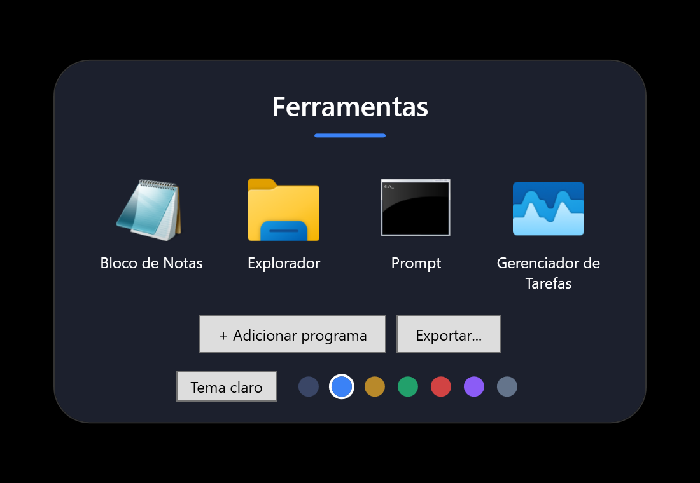
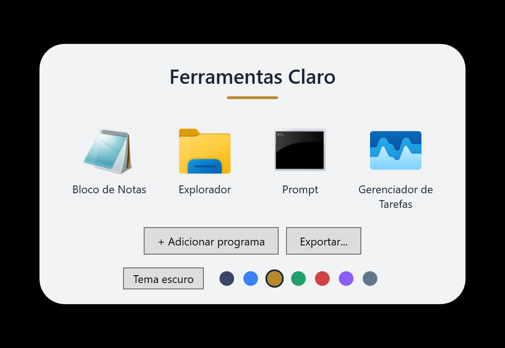
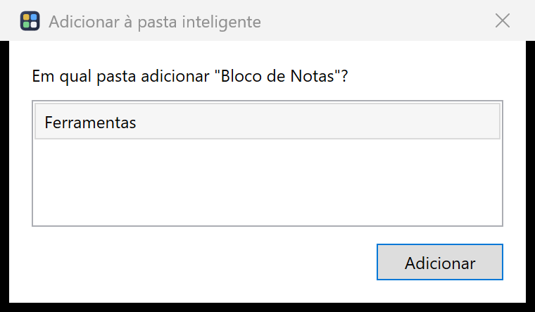

# DesktopFolders (MultiFolder)

**Pastas inteligentes para a Área de Trabalho do Windows.** Agrupe programas numa pasta e, ao clicar, ela
expande mostrando os apps para abrir, como nas pastas do iPhone e do macOS. Grátis e de código aberto.

| Tema escuro | Tema claro |
|---|---|
|  |  |

## O que faz

- **Pasta inteligente nativa.** Um item do próprio Windows: clique direito na Área de Trabalho →
  **Novo → Pasta inteligente**. Ela é um arquivo (`.0pasta`, extensão escondida) que guarda a lista de
  programas. Você move, renomeia (F2), copia e apaga pelo Explorador, **e ela continua funcionando com o
  programa fechado**. Duplo clique abre o popup.
- **Menu nativo do Windows nos apps.** Clique direito num app dentro da pasta mostra o menu de verdade do
  Windows (Abrir local do arquivo, Executar como administrador, Propriedades...) com as opções da pasta no final.
- **Adicionar de qualquer lugar.** Clique direito em um ou vários atalhos/programas →
  **Adicionar à pasta inteligente...** escolhe a pasta e o atalho sai da Área de Trabalho
  (volta ao lugar de origem se você remover da pasta).
- **Temas e cores.** Claro/escuro e 7 cores de destaque por pasta, salvos no arquivo da pasta.
- **Miniatura no ícone** (opcional): o ícone da pasta mostra os apps de dentro, na cor escolhida.
- **Compartilhar.** Exporte a pasta como `.dfpasta` (leva os atalhos junto); quem receber dá duplo clique para importar.
- **Camada de ícones livres** (opcional): o programa na bandeja desenha ícones e pastas posicionados
  onde você quiser, sobre o papel de parede, mesclados com o menu nativo do Windows.
- **Extras na bandeja:** backup automático para o OneDrive, iniciar com o Windows, importar pacote e
  verificação de atualizações.



## Instalação

1. Baixe o `DesktopFolders-Setup-<versão>.exe` em **[Releases](https://github.com/RFplanejamentofinanceiro-hub/MultiFolder-/releases)**.
2. Execute. Não precisa de administrador, e o .NET já vem incluído.
3. Na instalação, deixe marcada a opção **"Ativar o menu Novo e a miniatura"** (pede permissão de administrador
   **uma vez**). Veja o porquê abaixo.

> O instalador **não é assinado digitalmente**, então o Microsoft Defender SmartScreen pode avisar na primeira
> execução: clique em *Mais informações → Executar assim mesmo*. O código-fonte está aqui para conferir.

### Por que o passo de administrador?

O menu **Novo** e as **miniaturas** do Windows 11 só consideram tipos de arquivo registrados para a máquina
inteira. Sem esse passo tudo funciona **menos** a entrada em *Novo → Pasta inteligente* e a miniatura (dá para
criar pastas pelo ícone da bandeja → *Nova pasta inteligente...* ou importando um `.dfpasta`). Para ativar depois,
execute `Instalar-miniatura.cmd`, na pasta de instalação; para desativar, `Instalar-miniatura.cmd remover`.

## Como usar

1. **Criar:** botão direito na Área de Trabalho → *Novo → Pasta inteligente* (ou ícone da bandeja →
   *Nova pasta inteligente...*). Dê o nome (F2).
2. **Abrir:** duplo clique.
3. **Adicionar apps:** arraste atalhos/programas para o popup, use **+ Adicionar programa**, ou clique direito
   no atalho → *Adicionar à pasta inteligente...*.
4. **Reordenar:** arraste um app sobre outro dentro do popup.
5. **Tirar:** clique direito no app → *Remover da pasta* (o atalho volta à Área de Trabalho).
6. **Aparência:** botão de tema e bolinhas de cor no rodapé do popup.
7. **Compartilhar:** **Exportar...** gera um `.dfpasta`.

### Camada de ícones livres (opcional)

Abra o **DesktopFolders** pelo Menu Iniciar: ele fica na bandeja e desenha ícones e pastas posicionáveis por
cima do papel de parede. Arraste um app sobre outro para criar uma pasta; clique direito no vazio abre o menu
normal do Windows. Na bandeja você oculta os ícones padrão do Windows, liga o backup e outras opções.
Quem usa só as pastas inteligentes **não precisa** dessa camada.

## Limitações

- Testado no **Windows 11 x64**.
- Soltar arquivos *em cima* do ícone da pasta na Área de Trabalho não é possível para um tipo de arquivo
  próprio sem uma extensão nativa do Explorer; use *Adicionar à pasta inteligente...*.
- Só atalhos `.lnk` e `.url` são **movidos** da Área de Trabalho. Os da Área de Trabalho Pública exigem
  administrador e ficam onde estão.
- Itens que apontam para um `.exe` por caminho só abrem em outro PC se o programa existir lá.

## Dados e privacidade

- Pastas inteligentes: o próprio arquivo (JSON). Camada de ícones e atalhos movidos:
  `%APPDATA%\DesktopFolders`.
- A única conexão de rede é a **verificação de atualizações** (consulta a API pública do GitHub, no máximo uma vez
  por dia; desligável na bandeja). Nada é enviado, e o programa nunca se atualiza sozinho.
- O backup é uma cópia local para a pasta `DesktopFolders-Backup` do seu OneDrive.

## Desinstalar

*Configurações → Aplicativos → DesktopFolders* (ou o `unins000.exe` da pasta de instalação). Suas pastas
inteligentes e o layout **não** são apagados.

## Desenvolvimento

Requisitos: .NET 8 SDK e, para o instalador, Inno Setup 6 (`winget install JRSoftware.InnoSetup`).

```powershell
dotnet build -c Release                 # compila o app (WPF, .NET 8)
.\Thumb\build-thumb.ps1 -Out <pasta>    # compila o provedor de miniaturas (.NET Framework 4, já no Windows)
.\Criar-setup.ps1                       # gera Instalador\saida\DesktopFolders-Setup-<versão>.exe
```

Estrutura:

| Arquivo | Função |
|---|---|
| `MainWindow.*` | camada de ícones livres na Área de Trabalho |
| `FolderWindow.*` | popup da pasta inteligente (duplo clique) |
| `SmartFolder.cs` | registro do tipo `.0pasta`, menu Novo, miniatura |
| `ShellMenu.cs` | menu de contexto nativo do Windows mesclado |
| `Package.cs` | exportar/importar `.dfpasta` |
| `Updater.cs`, `Tools.cs` | atualizações, backup e iniciar com o Windows |
| `Thumb/DfThumb.cs` | provedor de miniaturas (COM, .NET Framework) |
| `Instalador/` | script do Inno Setup e scripts auxiliares |

Comandos de diagnóstico do executável: `--registrar`, `--remover-registro`, `--registrar-miniatura`,
`--remover-miniatura`, `--listar-novo <saida.txt>`, `--listar-menu <arquivo> <saida.txt>`.

## Licença

[MIT](LICENSE)
