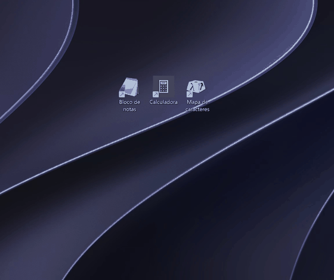

# DesktopFolders (MultiFolder)

**Pastas inteligentes para a Área de Trabalho do Windows.** Agrupe programas numa pasta e, ao clicar, ela
expande mostrando os apps para abrir, como nas pastas do iPhone e do macOS. Grátis e de código aberto.

[](#mod-do-windhawk)



| Tema escuro | Tema claro |
|---|---|
|  |  |

## O que faz

- **A pasta inteligente é um atalho comum.** Fica na Área de Trabalho como qualquer atalho (você move, renomeia
  com F2, copia e apaga pelo Explorador), tem um **ícone gerado com os apps de dentro** (os ícones reais dos
  seus atalhos, na cor da pasta) e abre o popup com duplo clique. Os dados ficam numa pasta do app, então o
  Windows sempre sabe abrir, mesmo com a Área de Trabalho no OneDrive, e não precisa de administrador.
- **Soltar um ícone sobre outro na Área de Trabalho.** Arraste um atalho e solte em cima de outro **ícone da
  Área de Trabalho do Windows**: o programa pede o nome e cria a pasta com os dois (aceita vários atalhos
  selecionados). A pasta nova aparece **no lugar do ícone alvo**. Soltar um atalho sobre uma **pasta inteligente
  que já existe** adiciona o atalho a ela. Um aviso com **Desfazer** aparece por alguns segundos. Fora dos ícones
  nada muda: o Explorador continua movendo os ícones normalmente. Funciona com o DesktopFolders aberto
  (ícone na bandeja; ligue *Iniciar com o Windows* para deixar sempre ativo). Só atalhos `.lnk`/`.url` são agrupados.
- **Menu nativo do Windows nos apps.** Clique direito num app dentro da pasta mostra o menu de verdade do
  Windows (Abrir local do arquivo, Executar como administrador, Propriedades...) com as opções da pasta no final.
- **Adicionar de qualquer lugar.** Clique direito em um ou vários atalhos/programas →
  **Adicionar à pasta inteligente...** escolhe a pasta e o atalho sai da Área de Trabalho
  (volta ao lugar de origem se você remover da pasta).
- **Temas e cores.** Claro/escuro e 7 cores de destaque por pasta; a cor também tinge o ícone da pasta.
- **Compartilhar.** Exporte a pasta como `.dfpasta` (leva os atalhos junto); quem receber dá duplo clique para importar.
- **Camada de ícones livres** (opcional): o programa na bandeja desenha ícones e pastas posicionados
  onde você quiser, sobre o papel de parede, mesclados com o menu nativo do Windows.
- **Extras na bandeja:** backup automático para o OneDrive, iniciar com o Windows, importar pacote e
  verificação de atualizações.


## Instalação

1. Baixe o `DesktopFolders-Setup-<versão>.exe` em **[Releases](https://github.com/RFplanejamentofinanceiro-hub/MultiFolder-/releases)**.
2. Execute. Não precisa de administrador, e o .NET já vem incluído.
3. Deixe marcada a opção *Iniciar com o Windows* se quiser o arrasto sobre ícones sempre ativo.

> O instalador **não é assinado digitalmente**, então o Microsoft Defender SmartScreen pode avisar na primeira
> execução: clique em *Mais informações → Executar assim mesmo*. O código-fonte está aqui para conferir.

### Atualizando da versão 1.1.x

A 1.1 guardava a pasta como um arquivo `.0pasta` na Área de Trabalho, que o Windows 11 não abre por duplo
clique (pergunta "com que programa abrir"). Ao instalar a 1.2 essas pastas são **convertidas automaticamente**
em atalhos (o arquivo original fica em `%APPDATA%\DesktopFolders\Pastas\legado`). Se você tinha rodado o passo
de administrador da 1.1, pode limpar o registro antigo com (como administrador):

```
DesktopFolders.exe --remover-miniatura
```

## Como usar

1. **Criar:** arraste um atalho e **solte sobre outro** na Área de Trabalho (pede o nome), ou botão direito no
   vazio da Área de Trabalho → *Mostrar mais opções → Nova pasta inteligente*, ou ícone da bandeja →
   *Nova pasta inteligente...*.
2. **Abrir:** duplo clique. Com o DesktopFolders aberto na bandeja, a pasta abre na hora (menos de 1 s).
   Sem limite de apps por pasta: com muitos, o popup ganha barra de rolagem.
3. **Adicionar apps:** solte um atalho sobre a pasta, arraste atalhos (ou apps do Menu Iniciar, inclusive da
   Store) para o popup, use **+ Adicionar programa**, ou clique direito no atalho → *Adicionar à pasta inteligente...*.
4. **Reordenar:** arraste um app sobre outro dentro do popup.
5. **Tirar:** clique direito no app → *Remover da pasta* (o atalho volta à Área de Trabalho).
6. **Aparência:** botão de tema e bolinhas de cor no rodapé do popup.
7. **Compartilhar:** **Exportar...** gera um `.dfpasta`.

### Camada de ícones livres (opcional)

Abra o **DesktopFolders** pelo Menu Iniciar: ele fica na bandeja e desenha ícones e pastas posicionáveis por
cima do papel de parede. Clique direito no vazio abre o menu normal do Windows. Na bandeja você oculta os
ícones padrão do Windows, liga o backup e outras opções. Quem usa só as pastas inteligentes **não precisa**
dessa camada, mas ela precisa estar aberta para o arrasto de ícone sobre ícone funcionar.

## Mod do Windhawk

Quem usa o [Windhawk](https://windhawk.net) pode instalar o mod **DesktopFolders: Instant Smart Folder Open**
([código](windhawk/desktopfolders-instant-open.wh.cpp)). Ele roda dentro do Explorador e:

- abre a pasta inteligente na hora e já em primeiro plano, com duplo clique ou Enter;
- opcionalmente abre com **um clique só** (configuração do mod); arrastar a pasta e Ctrl/Shift+clique continuam normais;
- não muda nenhum outro ícone nem as janelas do Explorador.

Com o mod ativo, o DesktopFolders da bandeja percebe e desliga o próprio detector de duplo clique.
O mod precisa do DesktopFolders instalado.

## Menu de botão direito do Windows 11

O Windows 11 tem um menu moderno e um clássico (*Mostrar mais opções*). Os comandos do DesktopFolders ficam no
clássico. Para usar sempre o clássico, ligue na bandeja *Usar o menu de botão direito clássico* e reinicie o
Explorador de Arquivos. É uma configuração só do seu usuário, sem administrador, e se desfaz desligando o item
(ou `reg delete "HKCU\Software\Classes\CLSID\{86ca1aa0-34aa-4e8b-a509-50c905bae2a2}" /f`).

## Limitações

- Testado no **Windows 11 x64**.
- Só atalhos `.lnk` e `.url` são **movidos** da Área de Trabalho. Os da Área de Trabalho Pública exigem
  administrador e ficam onde estão.
- Itens que apontam para um `.exe` por caminho só abrem em outro PC se o programa existir lá.
- Os ícones gerados ficam em `C:\ProgramData\DesktopFolders\Icones`. Isso é necessário: no Windows 11 o
  Explorador não consegue ler ícones de pastas novas dentro de `AppData`.

## Dados e privacidade

- Dados de cada pasta: `%APPDATA%\DesktopFolders\Pastas`. Camada de ícones e atalhos movidos:
  `%APPDATA%\DesktopFolders`.
- A única conexão de rede é a **verificação de atualizações** (consulta a API pública do GitHub, no máximo uma vez
  por dia; desligável na bandeja). Nada é enviado, e o programa nunca se atualiza sozinho.
- O backup é uma cópia local para a pasta `DesktopFolders-Backup` do seu OneDrive.

## Desinstalar

*Configurações → Aplicativos → DesktopFolders* (ou o `unins000.exe` da pasta de instalação). Suas pastas
inteligentes e os dados **não** são apagados.

## Desenvolvimento

Requisitos: .NET 8 SDK e, para o instalador, Inno Setup 6 (`winget install JRSoftware.InnoSetup`).

```powershell
dotnet build -c Release     # compila o app (WPF, .NET 8)
.\Criar-setup.ps1           # gera Instalador\saida\DesktopFolders-Setup-<versão>.exe
```

Estrutura:

| Arquivo | Função |
|---|---|
| `SmartFolder.cs` | pasta inteligente = atalho + dados; registro do botão direito; migração |
| `SmartFolderIcon.cs` | gera o ícone (.ico) da pasta com os ícones reais dos apps |
| `DesktopDrag.cs` | lê os ícones da Área de Trabalho e trata o arrasto de ícone sobre ícone |
| `FolderWindow.*` | popup da pasta inteligente (duplo clique) |
| `MainWindow.*` | camada de ícones livres e bandeja |
| `ShellMenu.cs` | menu de contexto nativo do Windows mesclado |
| `Package.cs` | exportar/importar `.dfpasta` |
| `Updater.cs`, `Tools.cs` | atualizações, backup, iniciar com o Windows |
| `Instalador/` | script do Inno Setup |

Comandos de diagnóstico do executável: `--registrar`, `--remover-registro`, `--migrar`, `--atualizar-icones`,
`--listar-icones <saida.txt>`, `--listar-menu <arquivo> <saida.txt>`.

## Licença

[MIT](LICENSE)
